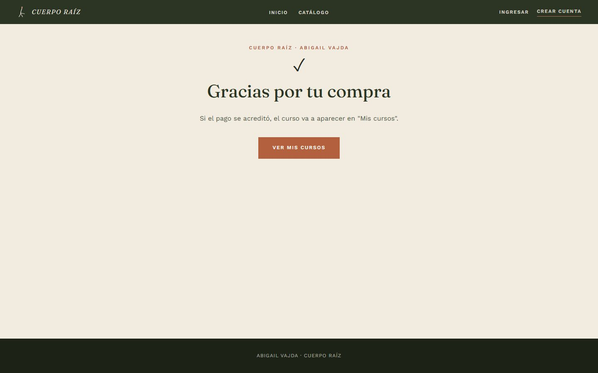
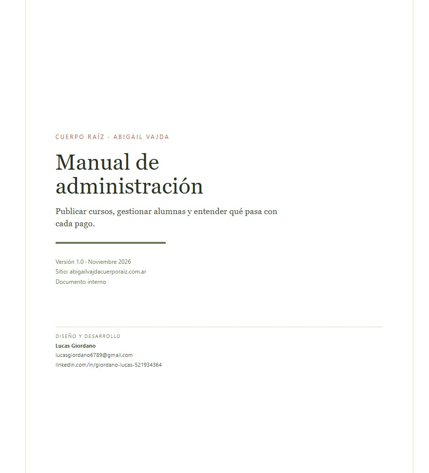

# Cuerpo Raíz · Plataforma de cursos online

Sitio y plataforma de venta de cursos para **Cuerpo Raíz · Abigail Vajda**, en producción desde noviembre de 2026.

**[abigailvajdacuerporaiz.com.ar](https://abigailvajdacuerporaiz.com.ar)**

Landing institucional multipágina, catálogo de cursos, cobro con Mercado Pago y aula virtual con progreso. El acceso a un curso se habilita **únicamente** cuando el backend verifica que el pago se acreditó: nunca por una redirección del navegador.


## El problema

La clienta dicta talleres y acompañamientos, y necesitaba vender cursos grabados sin depender de una plataforma de terceros que se quedara con una comisión y con los datos de sus alumnas. Además, el contenido tenía que quedar privado y ella tenía que poder publicar cursos **sin tocar código**.

La solución es un sitio propio con dos caras: una landing que sostiene la marca y una plataforma donde se compra, se aprende y se administra.

## Qué incluye

| Para la alumna | Para la administración |
|---|---|
| Catálogo y ficha de cada curso | Alta de cursos con slug, precio y portada |
| Registro, login y recuperación de contraseña | Módulos y contenidos: texto, PDF, Office, imagen y video |
| Compra con Mercado Pago (Checkout Pro) | Publicar / despublicar cursos |
| Aula con lecciones y barra de progreso | Historial de compras y estados de pago |
| "Mis cursos" con el avance de cada curso | Listado de usuarios y accesos |

<p align="center">
  
  
</p>

## Arquitectura

```
                    ┌──────────────────────────────┐
   Navegador  ──────│  React 19 + Vite (GitHub Pages)
                    └───────────────┬──────────────┘
                                    │
                     ┌──────────────┴───────────────┐
                     │           Supabase           │
                     │  Auth · Postgres + RLS       │
                     │  Storage · Edge Functions    │
                     └──────────────┬───────────────┘
                                    │
                     ┌──────────────┴───────────────┐
                     │  Mercado Pago · Orders API   │
                     └──────────────────────────────┘
```

| Pieza | Tecnología | Rol |
|---|---|---|
| Front | React 19, Vite 8, React Router 7 | Landing y app de cursos, build multipágina |
| Datos y sesión | Supabase (Postgres, Auth, Storage) | Tablas con RLS, archivos privados, cuentas |
| Cobros | Mercado Pago, Checkout Pro con Orders API | Creación de la orden y confirmación del pago |
| Backend | Edge Functions (Deno) | `create-checkout` y `mp-webhook` |
| Hosting | GitHub Pages + GitHub Actions | Deploy automático en cada push a `main` |
| Mails | Supabase Auth + SMTP de Resend | Confirmación, invitación y recuperación |

## El flujo de pago, paso a paso

1. La alumna toca **Comprar**. El navegador solo manda el `courseId`.
2. `create-checkout` lee el **precio desde la base**, no del navegador, y rechaza cursos en borrador o sin precio.
3. Si la alumna ya tiene el curso, responde `409` y no genera un cobro nuevo.
4. Se crea una orden local en `pending` con el monto real y se pide la orden a Mercado Pago.
5. Mercado Pago cobra y notifica al webhook.
6. `mp-webhook` valida la **firma HMAC**, consulta el estado real del pago en la API y compara monto y moneda contra la orden local.
7. Solo si todo coincide, marca la orden como aprobada y crea la inscripción. Recién ahí el curso aparece en el aula.

Si cualquiera de esos pasos falla, no hay acceso. El botón "volver al sitio" del checkout no otorga nada: es solo una pantalla.

## Decisiones técnicas que vale la pena mirar

**El precio nunca viaja desde el cliente.** El navegador manda un identificador de curso; el monto se lee de `courses.price_ars_cents` en el servidor. Cambiar el precio en el HTML no cambia lo que se cobra.

**La firma del webhook se prueba en dos variantes.** Mercado Pago calcula el manifiesto `id:…;request-id:…;ts:…;` en minúsculas para las notificaciones reales, pero su simulador usa el identificador con mayúsculas. El webhook valida primero la forma normalizada y después la exacta, y registra cuál coincidió en `payment_events`. Sin ese detalle, las notificaciones reales fallaban con `401`.

**No se valida la antigüedad del aviso.** Mercado Pago reintenta hasta 96 horas; un chequeo de `ts` habría rechazado reintentos legítimos. Reaplicar una firma vieja solo puede volver a confirmar un estado verdadero.

**Idempotencia en serio.** Un webhook puede llegar varias veces. La inscripción se crea con `upsert` sobre la clave `(user_id, course_id)` y `paid_at` solo se escribe si estaba vacío, para que un reintento no mueva la fecha del pago. Probado reenviando el mismo evento: una sola inscripción.

**El navegador no puede escribir dinero.** `orders`, `enrollments` y `payment_events` tienen RLS sin políticas de escritura: solo el servidor, con `service_role`, puede tocarlas. El rol de administración vive en `profiles`, no en metadata editable por el usuario.

**Los archivos son privados.** El material de cada lección vive en un bucket cerrado y se entrega con una URL firmada de 120 segundos. Copiar el enlace y compartirlo no sirve.

**SPA en GitHub Pages.** Pages no reescribe rutas, así que el build publica el HTML de la app también como `404.html`: las rutas profundas (`/cursos/mis-cursos`, `/curso/:slug/aprender`) funcionan al recargar o al abrir un enlace directo.

**El aula se descarga aparte.** El renderizador de Markdown y la vista de lección están en un chunk diferido: no pesan en la carga del catálogo.

## Pruebas realizadas

- Compra **aprobada**, **rechazada** y **pendiente** con las tarjetas de prueba de Mercado Pago, verificando en cada caso el estado de la orden y la existencia o no de la inscripción.
- **Replay** del mismo webhook para confirmar la idempotencia (una sola inscripción, `paid_at` intacto).
- Firma inválida → `401` y ningún acceso.
- Compra **real en producción** con tarjeta, desde el dominio publicado, con el webhook en modo producción.
- Recorrido completo en celular y en ventana privada, sin sesión de administración.

## Estructura del repositorio

```
├── index.html                 # landing institucional
├── cursos/index.html          # entrada de la app de cursos
├── src/
│   ├── App.jsx                # landing multipágina
│   └── cursos/
│       ├── App.jsx            # rutas de la plataforma
│       ├── pages/             # catálogo, ficha, aula, cuenta, admin/
│       ├── components/        # layout, guards, reproductor, portada
│       └── lib/               # Supabase, formato, video, limpieza de storage
├── supabase/
│   ├── functions/             # create-checkout · mp-webhook
│   ├── migrations/            # cambios de esquema
│   └── emails/                # plantillas de Auth con la marca
├── docs/                      # manual de administración + capturas
└── scripts/postbuild.mjs      # 404.html para las rutas de la SPA
```

## Correr en local

```bash
npm install
cp .env.example .env.local     # completar con las claves públicas del proyecto
npm run dev                    # http://localhost:5173
```

`.env.local` solo lleva la URL del proyecto y la clave **anon** de Supabase: son públicas por diseño. Los secretos de cobro viven en Supabase Secrets y nunca entran al repositorio.

```bash
# Funciones edge
npx supabase functions deploy create-checkout --use-api --remote=<project-ref> --yes
npx supabase functions deploy mp-webhook --no-verify-jwt --use-api --remote=<project-ref> --yes

# Secretos (valores fuera del repo y del chat)
npx supabase secrets set --remote=<project-ref> \
  MP_ACCESS_TOKEN=... MP_WEBHOOK_SECRET=...
```

## Documentación entregada

Además del sitio, el proyecto incluye un **manual de administración de 13 páginas** para la clienta: publicar cursos, cargar módulos y contenidos, interpretar los estados de pago, gestionar usuarios y resolver los problemas habituales.

[Ver el manual (PDF)](docs/manual-admin.pdf) · [Código fuente del manual](docs/manual-admin.html)

<a href="docs/manual-admin.pdf"></a>

## Estado

Sitio en producción. El catálogo se completa a medida que la clienta publica cursos desde el panel de administración.

---

## Autor

**Lucas Giordano** — diseño y desarrollo.
[lucasgiordano6789@gmail.com](mailto:lucasgiordano6789@gmail.com) · [LinkedIn](https://www.linkedin.com/in/giordano-lucas-521934364/)

## Sobre este repositorio

Proyecto publicado como caso de estudio con autorización de la clienta. **La marca, los textos y las imágenes son propiedad de Cuerpo Raíz · Abigail Vajda**; el código es de autoría propia. No se publican credenciales, datos de alumnas ni información personal.
